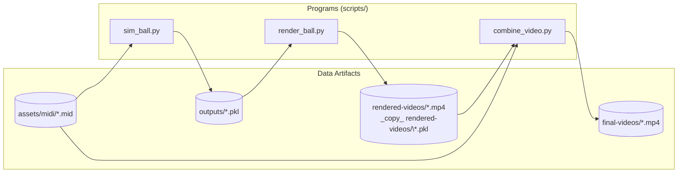

# bounce-music-py

Synchronize simulated bouncing-ball motion with MIDI music. The project requires Python 3.12 or newer.

*Sample demo: This video shows the simulated ball motion synchronized with audio (file: [assets/example.mp4](assets/example.mp4)).*

<https://github.com/user-attachments/assets/c6526d84-623b-481a-a3f1-d781043b0ae8>

## Setup

### Non-Python dependencies

- Download [FFmpeg](https://ffmpeg.org/download.html) and add it to your system `PATH`.

- Download [FluidSynth](https://www.fluidsynth.org/) and place it under `C:\tools\fluidsynth`.

- Download a SoundFont file, such as **FluidR3_GM**, and place it under `assets/sf2/`.

### Python package

Clone the repository and install it in editable mode:

```bash
pip install -e .
```

## Workflow

Place MIDI files under `assets/midi/`. The repository-based script workflow is:



Run the three stages with:

```bash
python scripts/sim_ball.py
python scripts/render_ball.py
python scripts/combine_video.py --music MIDI_NAME --tracks 0
```

Use `--help` on any script to inspect its options.

> [!NOTE]
> `sim_ball.py` uses [Hydra](https://hydra.cc/docs/intro/) with configuration files under `assets/conf/`, the configuration values can be overridden from the command line.
>
> Hydra will generate a configuration snapshot and `bounce_history.pkl` under `outputs/`.
